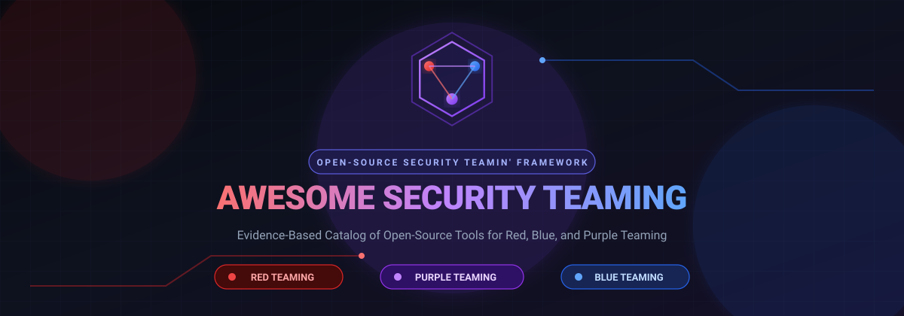

<div align="center">



<br/><br/>

[](https://wahyusutejo1986.github.io/awesome-security-teaming/)

[](LICENSE)
[](LICENSE-CODE)
[](https://www.python.org/)
[](CONTRIBUTING.md)
[](docs/evaluation-methodology.md)

[🌐 Live Web Portal](https://wahyusutejo1986.github.io/awesome-security-teaming/) • [🧭 Decision Matrix](docs/decision-matrix.md) • [🔴 Red Team](docs/red-team.md) • [🔵 Blue Team](docs/blue-team.md) • [🟣 Purple Team](docs/purple-team.md) • [📋 Evaluation Methodology](docs/evaluation-methodology.md) • [🏷️ Taxonomy](docs/taxonomy.md) • [🤝 Contributing](CONTRIBUTING.md)

</div>

---

# Awesome Security Teaming

> A community-driven, evidence-based catalog of open-source tools for Red, Blue, and Purple Teaming.

**Status:** Initial catalog; all imported entries are **unverified** until independently reviewed. Listed tools are **not endorsements** or claims of enterprise readiness. Repository URLs are initial candidates, not verified sources.

> 🧭 **Looking for architecture breakdowns, use cases, or TCO?** Read the [Decision Matrix & Cost Analysis Guide](docs/decision-matrix.md) for head-to-head comparisons (e.g. Suricata vs. Zeek, Atomic Red Team vs. Caldera, Sliver vs. Havoc).

---

## ⚡ Quick Navigation by Team

| Domain | Description | Catalog Link |
|---|---|---|
| **🧭 Strategy & TCO** | Use case decision matrix, architecture topologies, and cost analysis | [Decision Matrix](docs/decision-matrix.md) |
| **🔴 Red Team** | Offensive security, adversary simulation, penetration testing, C2, and discovery | [View Red Team Catalog](docs/red-team.md) |
| **🔵 Blue Team** | Defensive operations, security monitoring, packet analysis, detection, and DFIR | [View Blue Team Catalog](docs/blue-team.md) |
| **🟣 Purple Team** | Collaborative exercises, detection engineering, validation, and attack path analysis | [View Purple Team Catalog](docs/purple-team.md) |

---

## Browse tools

<!-- CATALOG:START -->

**20 tools** currently listed. All imported entries are unverified.

| Tool | Capability | Verification | Readiness |
|---|---|---|---|
| [Amass](https://github.com/owasp-amass/amass) | attack-surface-discovery | unverified | not-assessed |
| [Atomic Red Team](https://github.com/redcanaryco/atomic-red-team) | detection-validation | verified | not-assessed |
| [BloodHound](https://github.com/SpecterOps/BloodHound) | attack-path-analysis | unverified | not-assessed |
| ELK Stack | log-management | unverified | not-assessed |
| [Havoc](https://github.com/HavocFramework/Havoc) | command-and-control | unverified | not-assessed |
| [Metasploit](https://github.com/rapid7/metasploit-framework) | penetration-testing | unverified | not-assessed |
| [MITRE ATT&CK Navigator](https://github.com/mitre-attack/attack-navigator) | attack-mapping | verified | not-assessed |
| [MITRE Caldera](https://github.com/mitre/caldera) | adversary-emulation | unverified | not-assessed |
| [Mythic](https://github.com/its-a-feature/Mythic) | command-and-control | unverified | not-assessed |
| [Nmap](https://github.com/nmap/nmap) | network-discovery | verified | not-assessed |
| [OpenVAS](https://github.com/greenbone/openvas-scanner) | vulnerability-management | unverified | not-assessed |
| SentinelX | unclassified | unverified | not-assessed |
| [Sigma](https://github.com/SigmaHQ/sigma) | detection-engineering | unverified | not-assessed |
| [Sliver](https://github.com/BishopFox/sliver) | command-and-control | unverified | not-assessed |
| [Suricata](https://github.com/OISF/suricata) | network-detection | verified | not-assessed |
| [VECTR](https://github.com/SecurityRiskAdvisors/VECTR) | exercise-management | unverified | not-assessed |
| [Velociraptor](https://github.com/Velocidex/velociraptor) | dfir | unverified | not-assessed |
| [Wazuh](https://github.com/wazuh/wazuh) | security-monitoring | unverified | not-assessed |
| [Wireshark](https://github.com/wireshark/wireshark) | packet-analysis | verified | not-assessed |
| [Zeek](https://github.com/zeek/zeek) | network-analysis | unverified | not-assessed |

<!-- CATALOG:END -->

---

## Start here

- [Red Team catalog](docs/red-team.md) · [Blue Team catalog](docs/blue-team.md) · [Purple Team catalog](docs/purple-team.md)
- [Evaluation methodology](docs/evaluation-methodology.md) · [Taxonomy](docs/taxonomy.md) · [Contribution guide](CONTRIBUTING.md)
- [Security and responsible use](SECURITY.md)

## Local development

Requires **Python 3.10+**; no third-party Python dependencies.

```bash
python scripts/validate.py
python scripts/generate.py
python -m unittest discover -s tests -v
```

Edit `data/tools.json`, run the commands, and commit generated Markdown. `data/raw/` preserves the original CSV. The catalog deliberately does not execute or install any listed tool.

## Scope

This repository is an **informational catalog**, not a deployment guide, security product, certification, or guarantee of licensing/compliance. Use tools only on systems you own or are explicitly authorized to assess.

## License

Catalog content is available under [CC BY 4.0](LICENSE). Scripts are provided under [MIT](LICENSE-CODE). Upstream projects retain their own licenses; verify each upstream license independently.
