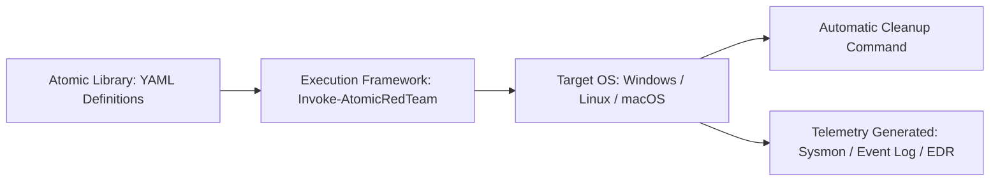

# 🛡️ Tool Profile: Atomic Red Team

> Simple, Portable, Open-Source Detection Tests Mapped to the MITRE ATT&CK Framework.

---

## 📌 Ringkasan Eksekutif

| Parameter | Keterangan |
| :--- | :--- |
| **Kategori Tim** | 🟣 Purple Team / 🔴 Red Team / 🔵 Blue Team |
| **Kapabilitas Utama** | `detection-validation`, `adversary-emulation` |
| **Model Arsitektur** | Standalone Script Execution Library (YAML / PowerShell / Bash / Python) |
| **Lisensi** | MIT License (Open Source) |
| **Pemeliharaan (*Maintenance*)** | Sangat Aktif (Red Canary & Komunitas Global) |
| **Situs Resmi** | [atomicredteam.io](https://atomicredteam.io/) |
| **Repositori Resmi** | [github.com/redcanaryco/atomic-red-team](https://github.com/redcanaryco/atomic-red-team) |

---

## 🎯 Kapan Menggunakan Atomic Red Team?

### ✅ Skenario Terbaik (Best Use Cases)
1. **Validasi Rule Deteksi (Unit Testing)**: Setelah menulis aturan Sigma atau alert EDR baru, jalankan test atomik yang spesifik (misal: `T1003.001 LSASS Memory Dump`) untuk membuktikan apakah alert menyala.
2. **Uji Coba Postur Keamanan Endpoint (Baseline Testing)**: Memastikan sensor EDR/AV (Microsoft Defender for Endpoint, CrowdStrike, SentinelOne) aktif dan memblokir teknik eksekusi dasar.
3. **Integrasi CI/CD Security Pipeline**: Menjalankan tes regresi otomatis pada build gold-image server sebelum dideploy ke produksi.
4. **Pembelajaran Praktis MITRE ATT&CK**: Memahami persis bagaimana perintah berbahaya dieksekusi di level sistem operasi baris demi baris.

### ❌ Kapan JANGAN Menggunakan Atomic Red Team?
- **Simulasi Penyerang Rantai Penuh (*Multi-stage Attack Emulation*)**: Tes atomik dieksekusi secara terpisah (*isolated*), bukan sebagai kampanye penyerangan dinamis yang berantai. Gunakan MITRE Caldera untuk skenario rantai penuh.
- **Asesmen Evasion Tingkat Lanjut**: Perintah atomik standar sudah sangat dikenal signature-nya oleh AV/EDR komersial.

---

## 🏗️ Cara Kerja & Eksekusi



Setiap tes atomik terdiri atas 4 bagian inti:
1. **Prereq Check**: Memeriksa apakah dependensi/file uji sudah siap.
2. **Get Prereqs**: Mengunduh atau menyiapkan file uji secara otomatis.
3. **Execution**: Menjalankan teknik serangan yang dipetakan ke nomor teknik ATT&CK.
4. **Cleanup**: Mengembalikan kondisi sistem ke keadaan semula agar sistem tidak kotor.

---

## 💰 Kebutuhan Hardware & Estimasi Biaya (TCO)

- **Lisensi Perangkat Lunak**: 100% Gratis (MIT).
- **Infrastruktur yang Diperlukan**: Tidak memerlukan server terpisah. Dijalankan langsung dari terminal PowerShell/Bash pada mesin lab atau mesin target pengujian.
- **Biaya Operasional**: Nyaris $0. Satu-satunya biaya adalah waktu analis dalam menganalisis telemetri yang dihasilkan.

---

## 🚀 Perintah Cepat (Quickstart via PowerShell)

```powershell
# 1. Install Modul Invoke-AtomicRedTeam
IEX (IWR 'https://raw.githubusercontent.com/redcanaryco/invoke-atomicredteam/master/install-atomicredteam.ps1' -UseBasicParsing);
Install-AtomicRedTeam -getAtomics

# 2. Cek Detail Tes untuk Teknik Tertentu (Contoh: T1059.001 PowerShell)
Invoke-AtomicTest T1059.001 -ShowDetailsBrief

# 3. Jalankan Tes Nomor 1
Invoke-AtomicTest T1059.001 -TestNumbers 1

# 4. Bersihkan Artefak Pasca Pengujian
Invoke-AtomicTest T1059.001 -TestNumbers 1 -Cleanup
```
