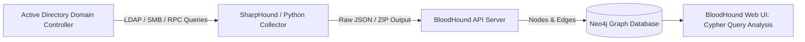

# 🛡️ Tool Profile: BloodHound

> Visual Active Directory and Azure/Entra ID Attack Path Analysis Engine.

---

## 📌 Ringkasan Eksekutif

| Parameter | Keterangan |
| :--- | :--- |
| **Kategori Tim** | 🔴 Red Team / 🔵 Blue Team / 🟣 Purple Team |
| **Kapabilitas Utama** | `attack-path-analysis` |
| **Model Arsitektur** | Ingestor (SharpHound/AzureHound) + Neo4j Graph DB + Web UI |
| **Lisensi** | MIT License / Apache 2.0 (BloodHound Community Edition) |
| **Pemeliharaan (*Maintenance*)** | Sangat Aktif (SpecterOps) |
| **Situs Resmi** | [bloodhoundenterprise.io](https://bloodhoundenterprise.io/) |
| **Repositori Resmi** | [github.com/SpecterOps/BloodHound](https://github.com/SpecterOps/BloodHound) |

---

## 🎯 Kapan Menggunakan BloodHound?

### ✅ Skenario Terbaik (Best Use Cases)
1. **Attack Path Mapping (Red Team)**: Menemukan rute terpendek tersembunyi dari akun user biasa (*standard unprivileged user*) menuju hak akses tertinggi (*Domain Admin* / Tier 0) memanfaatkan hubungan hak akses yang transitif (ACLs, group nesting, local admin rights).
2. **Hardening & Posture Management (Blue Team)**: Menemukan dan memutus rantai hubungan hak akses berlebih (*unintended permission escalation chains*) sebelum dieksploitasi musuh.
3. **Audit Lingkungan Hybrid Cloud**: Memetakan relasi hak akses antara on-premise Active Directory dan Microsoft Azure / Entra ID.

### ❌ Kapan JANGAN Menggunakan BloodHound?
- **Lingkungan Non-Active Directory / Tanpa Windows Domain**: BloodHound dirancang secara khusus untuk memodelkan izin graf Active Directory dan Azure; tidak berlaku untuk arsitektur Linux IAM murni tanpa AD.

---

## 🏗️ Arsitektur & Alur Kerja



---

## 💰 Kebutuhan Hardware & Estimasi Biaya (TCO)

- **Lisensi Perangkat Lunak**: Gratis (Community Edition).
- **Kebutuhan Hardware Server**:
  - Domain kecil (< 5.000 objek): 2-4 vCPU, 8 GB RAM.
  - Domain enterprise (> 100.000 objek): 8-16 vCPU, 32-64 GB RAM (Neo4j JVM heap memory intensif).
- **Biaya**: Gratis untuk Community Edition (Dockerized).

---

## 🚀 Perintah Cepat (Quickstart via Docker)

```bash
# Menjalankan BloodHound Community Edition via Docker Compose
curl -L https://ghst.ly/getbhce -o docker-compose.yml
docker compose up -d

# Menjalankan pengumpulan data SharpHound pada domain target (dari mesin Windows yang terhubung ke domain)
.\SharpHound.exe -c All --zipfilename ad_collection.zip
```
