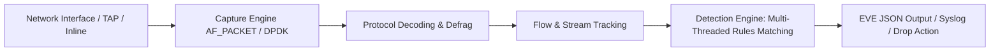

# 🛡️ Tool Profile: Suricata

> High-performance Network Threat Detection, IDS, IPS, and Network Security Monitoring Engine.

---

## 📌 Ringkasan Eksekutif

| Parameter | Keterangan |
| :--- | :--- |
| **Kategori Tim** | 🔵 Blue Team |
| **Kapabilitas Utama** | `network-detection`, `network-analysis` |
| **Model Arsitektur** | Sensor Network / Inline Gateway (Multi-threaded C) |
| **Lisensi** | GPL-2.0 (Open Source) |
| **Pemeliharaan (*Maintenance*)** | Aktif (Didukung oleh OISF - Open Information Security Foundation) |
| **Situs Resmi** | [suricata.io](https://suricata.io/) |
| **Repositori Resmi** | [github.com/OISF/suricata](https://github.com/OISF/suricata) |

---

## 🎯 Kapan Menggunakan Suricata?

### ✅ Skenario Terbaik (Best Use Cases)
1. **Network Intrusion Detection System (NIDS)**: Memantau traffic SPAN port/TAP untuk mendeteksi exploit, scan mencurigakan, dan pola serangan berbasis rule (Emerging Threats ruleset).
2. **Network Intrusion Prevention System (NIPS)**: Dijalankan secara *inline* menggunakan Netfilter NFQUEUE atau AF_PACKET untuk secara otomatis **menolak atau memblokir (*drop*)** paket serangan.
3. **Ekstraksi File Otomatis**: Mengekstrak file biner (seperti `.exe`, `.dll`, `.pdf`) yang ditransmisikan melalui traffic jaringan untuk dikirim ke sandbox malware (Cuckoo / CAPEv2).
4. **Pencatatan Log Protokol Standar (EVE JSON)**: Menghasilkan log terpadu format JSON (`eve.json`) yang sangat mudah diintegrasikan ke Elasticsearch, Splunk, atau Wazuh.

### ❌ Kapan JANGAN Menggunakan Suricata?
- **Host-based Inspection**: Suricata tidak dapat melihat aktivitas internal OS (proses, registri, file lokal). Gunakan Sysmon atau Wazuh untuk kebutuhan ini.
- **Trafik Terenkripsi Tanpa Decryption**: Jika traffic sepenuhnya terenkripsi TLS end-to-end tanpa SSL/TLS decryption proxy, efektivitas deep inspection muatan paket akan berkurang (hanya meta-sertifikat yang terlihat).

---

## 🏗️ Arsitektur & Topologi

Suricata menggunakan arsitektur pemrosesan multi-threaded modern yang dapat mendistribusikan beban paket melintasi seluruh core CPU:



---

## 💰 Kebutuhan Hardware & Estimasi Biaya (TCO)

- **Lisensi Perangkat Lunak**: 100% Gratis & Open Source.
- **Hardware Minimum (Lab / SOHO)**: 2 vCPU, 4 GB RAM, 1x NIC Gigabit.
- **Hardware Produksi (Trafik 1 - 10 Gbps)**:
  - 16-32 Core CPU (dukungan AVX-512 sangat dianjurkan).
  - 32-64 GB RAM.
  - Kartu Jaringan Dedicated (Intel X520 / Mellanox ConnectX) dengan driver DPDK atau AF_PACKET.
- **Biaya Storage**: ~20 GB - 200 GB per hari untuk berkas `eve.json` tergantung kepadatan traffic.

---

## ⚖️ Kelebihan & Keterbatasan

### Kelebihan
- **Multi-threaded Native**: Performa pemrosesan jauh lebih tinggi dibanding Snort 2 single-threaded klasik.
- **Format EVE JSON Terpadu**: Integrasi mudah dengan seluruh pipeline log modern.
- **Aturan Ekosistem Luas**: Kompatibel dengan ribuan aturan *Emerging Threats (ET Open)* gratis.

### Keterbatasan
- Memerlukan tuning aturan secara berkala untuk meminimalkan *false positives*.
- Membutuhkan kartu capture jaringan yang stabil agar tidak terjadi *packet drop* pada beban puncak.

---

## 🚀 Perintah Cepat (Quickstart)

```bash
# Instalasi pada Ubuntu / Debian
sudo add-apt-repository ppa:oisf/suricata-stable
sudo apt update && sudo apt install suricata -y

# Memperbarui aturan Emerging Threats
sudo suricata-update

# Menjalankan pemantauan pada interface eth0
sudo suricata -c /etc/suricata/suricata.yaml -i eth0
```
