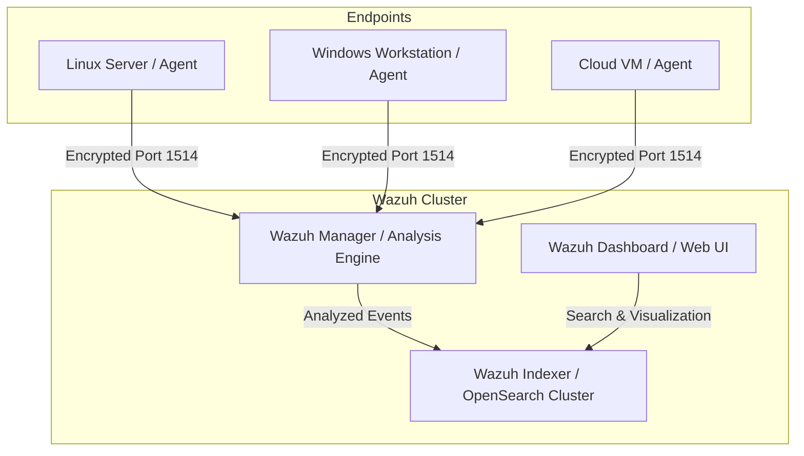

# 🛡️ Tool Profile: Wazuh

> The Open Source Security Platform for Unified SIEM and XDR.

---

## 📌 Ringkasan Eksekutif

| Parameter | Keterangan |
| :--- | :--- |
| **Kategori Tim** | 🔵 Blue Team / 🟣 Purple Team |
| **Kapabilitas Utama** | `security-monitoring`, `log-management`, `detection-engineering` |
| **Model Arsitektur** | Distributed Agent-to-Server (Wazuh Agent + Server + Indexer) |
| **Lisensi** | GPLv2 (Server/Agent), Apache 2.0 (Indexer/Dashboard) |
| **Pemeliharaan (*Maintenance*)** | Sangat Aktif (Wazuh Inc.) |
| **Situs Resmi** | [wazuh.com](https://wazuh.com/) |
| **Repositori Resmi** | [github.com/wazuh/wazuh](https://github.com/wazuh/wazuh) |

---

## 🎯 Kapan Menggunakan Wazuh?

### ✅ Skenario Terbaik (Best Use Cases)
1. **Host-based Intrusion Detection (HIDS) & XDR**: Pemantauan integritas file (*File Integrity Monitoring - FIM*), deteksi rootkit/malware, dan pengawasan registri Windows serta log Linux.
2. **Kepatuhan Regulasi & Standar Industri**: Pemetaan kontrol otomatis untuk standar PCI-DSS, GDPR, HIPAA, NIST SP 800-53, dan CIS Benchmarks.
3. **Pusat SIEM Terpadu**: Mengumpulkan log dari ratusan hingga ribuan server/endpoint Windows, Linux, macOS, kontainer Docker, AWS/GCP, dan perangkat jaringan (Syslog).
4. **Respon Otomatis (Active Response)**: Menjalankan skrip mitigasi otomatis saat alert kritis terdeteksi (seperti memblokir IP penyerang di firewall lokal atau memutus sesi pengguna).

### ❌ Kapan JANGAN Menggunakan Wazuh?
- **Full Packet Capture (FPC) atau Analisis Deep Packet**: Wazuh bukan Network Packet Analyzer; gunakan bersama Suricata atau Zeek untuk visibilitas jaringan murni.
- **Lingkungan Tanpa Agent (Agentless) untuk Analisis Memory/Live Forensics**: Meskipun mendukung Syslog agentless, kapabilitas utama Wazuh bergantung pada pemasangan agent lokal di tiap host.

---

## 🏗️ Arsitektur & Topologi



---

## 💰 Kebutuhan Hardware & Estimasi Biaya (TCO)

- **Lisensi Perangkat Lunak**: 100% Gratis & Open Source.
- **Single-Node All-in-One (Uji Coba / < 100 Agent)**:
  - 4-8 vCPU, 16 GB RAM, 100 GB SSD.
- **Cluster Produksi Terdistribusi (> 1.000 Agent)**:
  - 2x Wazuh Manager (8 vCPU, 16 GB RAM).
  - 3x Wazuh Indexer Nodes (8-16 vCPU, 32-64 GB RAM, Fast NVMe SSD).
  - 1x Wazuh Dashboard (4 vCPU, 8 GB RAM).
- **Biaya Penyimpanan Storage**: ~50 GB - 500 GB per bulan per 100 endpoint tergantung frekuensi log audit.

---

## 🚀 Perintah Cepat (Quickstart)

```bash
# Instalasi All-in-One Instan via Skrip Resmi (Ubuntu/RHEL)
curl -sO https://packages.wazuh.com/4.9/wazuh-install.sh
sudo bash ./wazuh-install.sh -a

# Pemasangan Agen pada Ubuntu Linux Target
curl -so wazuh-agent.deb https://packages.wazuh.com/4.x/apt/pool/main/w/wazuh-agent/wazuh-agent_4.9.0-1_amd64.deb
sudo WAZUH_MANAGER='IP_WAZUH_SERVER' dpkg -i ./wazuh-agent.deb
sudo systemctl daemon-reload && sudo systemctl enable --now wazuh-agent
```
