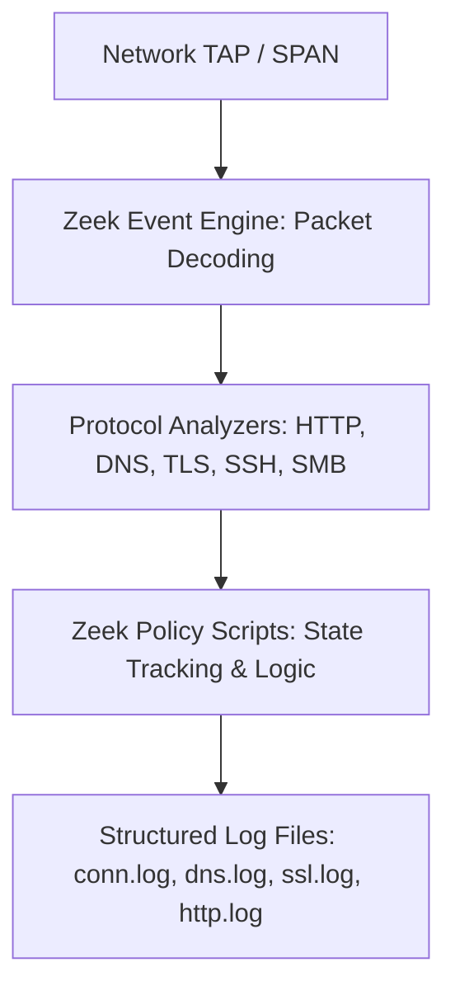

# 🛡️ Tool Profile: Zeek (Formerly Bro)

> The World's Leading Open-Source Network Security Monitoring and Structured Metadata Engine.

---

## 📌 Ringkasan Eksekutif

| Parameter | Keterangan |
| :--- | :--- |
| **Kategori Tim** | 🔵 Blue Team / 🟣 Purple Team |
| **Kapabilitas Utama** | `network-analysis`, `security-monitoring` |
| **Model Arsitektur** | Event-Driven Network Protocol Analyzer (C++ & Zeek Scripting) |
| **Lisensi** | BSD-3-Clause (Open Source) |
| **Pemeliharaan (*Maintenance*)** | Aktif (Didukung oleh The Zeek Project & Corelight) |
| **Situs Resmi** | [zeek.org](https://zeek.org/) |
| **Repositori Resmi** | [github.com/zeek/zeek](https://github.com/zeek/zeek) |

---

## 🎯 Kapan Menggunakan Zeek?

### ✅ Skenario Terbaik (Best Use Cases)
1. **Network Security Monitoring (NSM) Skala Enterprise**: Menerjemahkan paket raw biner menjadi log protokol terstruktur yang bersih (DNS query & response, SSL/TLS handshake metadata, HTTP request/response, SMB connection, SSH key exchange).
2. **Behavioral & Anomaly Detection**: Mendeteksi anomali jaringan melalui logika skrip (*Zeek scripts*) tanpa bergantung pada signature biner yang statis.
3. **Analisis Transaksi TLS/SSL Pasif**: Mengekstrak nama sertifikat, cipher suite, issuer, JA3/JA4 fingerprinting dari trafik terenkripsi tanpa perlu membuka enkripsi payload.
4. **Threat Hunting**: Memungkinkan analis mencari pola jahat (misal: DNS beaconing atau SSH brute force) dengan query SQL/Elasticsearch pada log Zeek yang rapi.

### ❌ Kapan JANGAN Menggunakan Zeek?
- **Inline Packet Blocking / IPS**: Zeek dirancang sebagai sensor pasif; Zeek tidak memblokir paket secara inline. Gunakan Suricata untuk kebutuhan pencegahan inline.
- **Pencarian Signature Exploit Instan**: Jika Anda hanya ingin mencocokkan signature CVE sederhana, Suricata atau Snort lebih cepat diimplementasikan.

---

## 🏗️ Arsitektur & Topologi



---

## 💰 Kebutuhan Hardware & Estimasi Biaya (TCO)

- **Lisensi Perangkat Lunak**: Gratis (BSD-3-Clause).
- **Hardware Minimum**: 4 vCPU, 8 GB RAM (Trafik kantor skala kecil < 100 Mbps).
- **Cluster Produksi (Trafik 5 - 40 Gbps)**:
  - Arsitektur Cluster: 1x Manager, 1x Proxy, N x Workers.
  - Setiap Worker membutuhkan 4-8 core CPU dan 8-16 GB RAM per 1-2 Gbps traffic.
- **Biaya Penyimpanan Log**: Log Zeek berukuran sekitar 1% - 5% dari total volume raw traffic (misal: 1 TB raw PCAP menghasilkan ~10 - 50 GB log Zeek).

---

## 🚀 Perintah Cepat (Quickstart)

```bash
# Menjalankan Zeek secara pasif pada file PCAP
zeek -r capture.pcap

# Melihat ringkasan koneksi yang dihasilkan
cat conn.log | zeek-cut id.orig_h id.resp_h id.resp_p proto duration

# Melihat semua query DNS yang tercatat
cat dns.log | zeek-cut query answers
```
